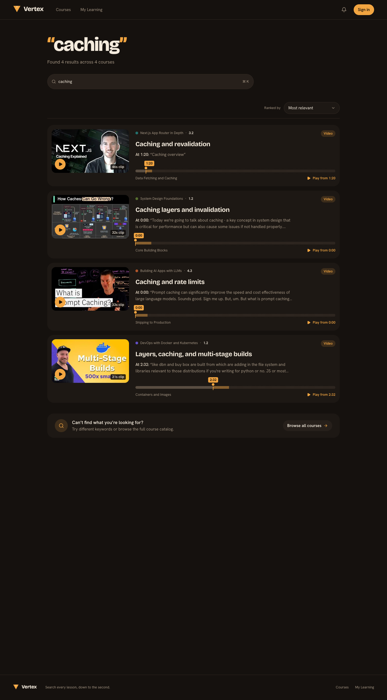
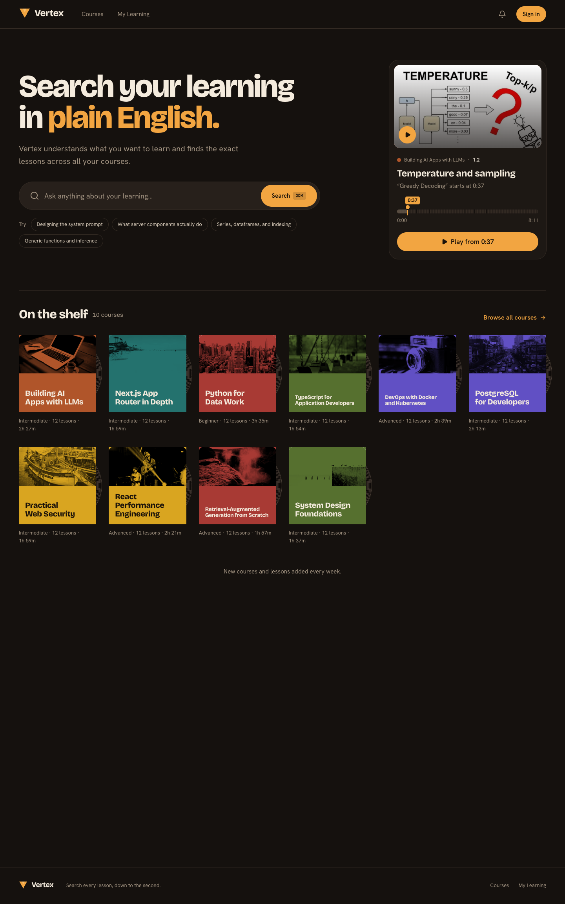
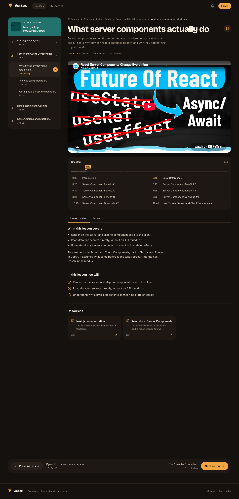
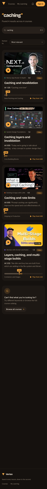

# Vertex

**Search your learning in plain English.** Vertex is a video learning platform. You type a question like *"where did they explain caching?"* and get a ranked list of results. Each result opens the lesson video at the exact second the topic comes up.

**[Live demo → vertex-delta-orpin.vercel.app](https://vertex-delta-orpin.vercel.app)** · try searching for *"caching"* or *"server components"*



## What it does

- **Search that lands on the moment.** It searches lesson titles, lesson notes, video chapters and transcript snippets, then merges and ranks the results. Click **Play from 1:20** and the video starts at 1:20, inside the site.
- **Results come from real data.** The language model only picks a lesson id and a second. The server then looks up every title, timestamp and label in the CMS. If the lesson or the timestamp doesn't exist, the result is dropped.
- **A full course platform around the search.** Catalog, course pages, lesson pages with the video, notes, key points and resources, and sign-in.
- **Videos are indexed offline.** A command-line script pulls chapters and captions from YouTube, Vimeo or Bunny and splits them into 30-second searchable chunks.

| Home | Lesson | Mobile |
| --- | --- | --- |
|  |  |  |

## Tech stack

| Area | Tools |
| --- | --- |
| Web app | Next.js 16 (App Router, React Server Components), React 19, TypeScript, Tailwind CSS v4 |
| Content | Sanity (separate Studio, private dataset, GROQ, Portable Text, TypeGen) |
| AI search | Vercel AI SDK 7, Google Gemini, Sanity Context MCP |
| Auth | Clerk (route protection in middleware) |
| Analytics | PostHog (product events and server logs over OpenTelemetry) |
| Validation | Zod |
| Hosting | Vercel |

## How search works

```
browser ──GET /api/search?q=──▶ Next.js route (server only)
                                 │
                                 ├─ 1. split the query into keywords, drop stop words
                                 ├─ 2. two GROQ queries through the Sanity Context MCP
                                 │     • lessons: title (boosted ×3), notes, key points
                                 │     • videos: chapters first, transcript chunks only as a fallback
                                 ├─ 3. Gemini ranks the matches and returns {lessonId, second}[]
                                 ├─ 4. each result is checked against Sanity as it arrives
                                 └─ 5. result cards stream back as NDJSON ──▶ results page
```

Design decisions worth calling out:

- **The model only ranks.** Code builds the queries, so the model never writes GROQ. It sees a small, filtered set of matches (at most 2 moments per video), never a whole transcript.
- **Grounding is enforced in code.** [`lib/search.ts`](lib/search.ts) rejects a result unless the lesson belongs to a course and the claimed second matches a real chapter or chunk. Labels such as "Lesson 3.2" are worked out from the module order, never stored.
- **Results stream in.** Each card is checked as soon as the model emits it, but cards are written in the model's ranking order, so the first card appears quickly and the order is still correct.
- **Specific beats broad.** Matches in a title or chapter label are weighted 3× higher than matches in notes or transcripts.

## Architecture

```
.
├── app/            Next.js routes: home, catalog, course, lesson, search, /api/search
├── components/     UI components (cards, groove bar, header, search results)
├── lib/            Pure logic with tests: search grounding, labels, video embeds, pagination
├── sanity/         Server-only Sanity client, GROQ queries
├── proxy.ts        Clerk middleware (browsing stays public)
└── studio/         Standalone Sanity Studio
    ├── schemaTypes/        course, module, lesson, instructor, category, video
    └── scripts/
        ├── ingest/         Offline caption/chapter ingestion (YouTube, Vimeo, Bunny)
        ├── seed/           Seed dataset (10 courses, 120 lessons)
        └── context/        Search config document for the Context MCP
```

Security rules the code follows:

- The browser never holds a Sanity token, never calls the LLM or the MCP, and never writes data. The only keys sent to the client are the Clerk publishable key and the PostHog project key.
- Pages fetch content on the server with a read-only token from a private dataset.
- The search input is validated with Zod (2–200 characters) and reduced to `[a-z0-9]` keywords before it reaches any query.
- Video embeds are built only from validated provider ids, using `youtube-nocookie.com` for YouTube.

## Run it locally

You need Node 24, a Sanity project, a Clerk app, a Gemini API key, and a PostHog project.

```bash
# web app
npm install
cp .env.example .env.local      # fill in the keys; .env.example lists every one
npm run dev                     # http://localhost:3000

# studio (separate terminal)
cd studio
npm install
npx sanity dataset import scripts/seed/seed.ndjson production
npm run deploy && npm run schema:deploy   # the Context MCP needs a deployed Studio
npm run ingest                            # build chapter/transcript docs for every lesson video
```

## Checks

```bash
npx tsc --noEmit
npm run lint
node --test lib/*.test.ts                        # web unit tests
node --test studio/scripts/ingest/parse.test.ts  # caption parser tests
npm run build
```

## Status

Done: content model, Clerk auth, catalog, course and lesson pages, video ingestion, AI search, PostHog analytics, and the "Listening Room" redesign (see [DESIGN.md](DESIGN.md)).

Next: instructor pages, My Learning, and progress tracking (resume position and completed lessons, written through a server route).

## How it was built

Every feature started as a written spec in [`prompts/`](prompts/) covering the goal, decisions, security notes, acceptance criteria and manual test steps. It then shipped as its own pull request. [AGENTS.md](AGENTS.md) holds the architecture rules the whole codebase follows.
